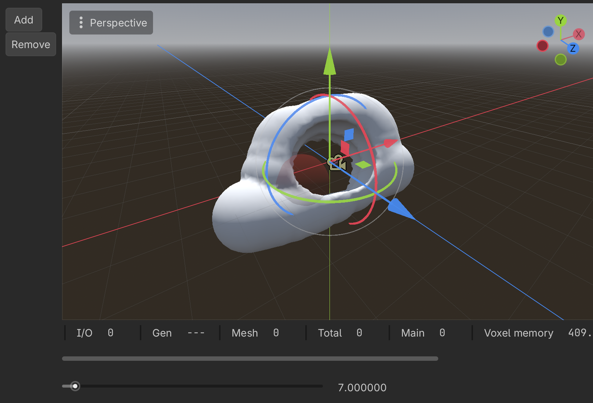

# VoxelEditor

A Godot editor plugin for working with [godot_voxel](https://github.com/Zylann/godot_voxel)

## Features

Currently, **very** limited.

- Add/Subtract from a `VoxelLodTerrain`
- Texture Painting
- Spherical Brushes
- Target visualization
- Undo Support

## Integration

- First, make sure you have Voxel Tools installed and working
- Drop this into your `/addons` directory
- Enable the plugin with Project > Project Settings > Plugins
- Select a `VoxelTerrain` node in the spacial editor

Right now, the texture painting tool only works with a mesher in mixel4 texturing mode.

## Texturing

Getting texturing working is not very straightforward. This is an area I'd really like to improve, so if you have ideas, please send them my way!

- Ensure your mesher is `VoxelMesherTransvoxel`
- Set the mesher's texturing mode to `Mixel4`
- Assign a new `ShaderMaterial` to the terrain
- Use the "mixel4_array.gdshader" shader for that material, which comes from this plugin
- Assign its "U Albedo Array" to a texture array with your textures

## Contributing and Collaboration

I would love to hear from you! Issues or pull requests work great.

By participating in this project you agree to abide by the [Contributor Code of Conduct](CODE_OF_CONDUCT.md).
